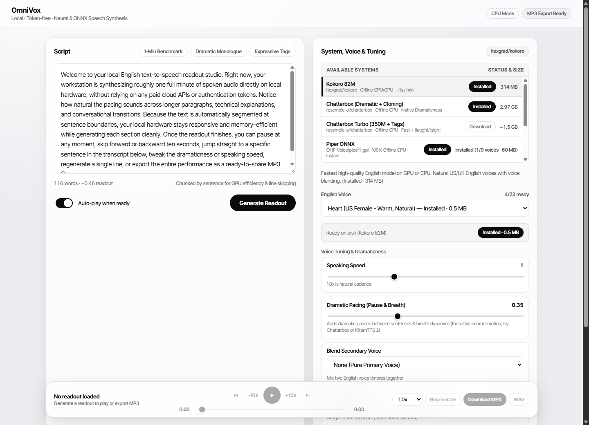

# OmniVox


OmniVox is a local, token-free English text-to-speech studio that unifies multiple open-source neural and ONNX TTS engines inside a single browser interface. Paste a script, pick an English voice, tune dramaticness and pacing, play/pause/skip/regenerate by sentence, and export MP3 or WAV audio on your own hardware.



## Audio Samples

- **Standard Readout Sample (MP3):** [samples/omnivox_sample_standard.mp3](samples/omnivox_sample_standard.mp3)
- **Dramatic Readout Sample (MP3):** [samples/omnivox_sample_dramatic.mp3](samples/omnivox_sample_dramatic.mp3)

## Features

- **No API Keys or Paid Tokens:** Runs locally on CPU or NVIDIA CUDA GPU (with optional zero-GPU online Edge TTS).
- **Live System and Voice Cache Status:** Shows which engines and English voices are already cached on disk alongside estimated download sizes before you generate.
- **Cancel Active Generation:** Stop queued or multi-sentence synthesis cleanly mid-run.
- **Engine-Specific Tuning and Dramaticness:**
  - **Kokoro 82M (`hexgrad/kokoro`):** Fast English synthesis (~1s per minute of audio on a mid-range CUDA GPU), speaking speed, secondary voice blending, and pause pacing.
  - **Chatterbox (`resemble-ai/chatterbox`):** Native Dramaticness (`exaggeration`) slider, CFG pacing control, vocal variety (`temperature`), and zero-shot voice cloning.
  - **Chatterbox Turbo (`resemble-ai/chatterbox`):** Streamlined 350M English model with native paralinguistic tags (`[laugh]`, `[chuckle]`, `[sigh]`, `[gasp]`, `[cough]`).
  - **Piper ONNX (`OHF-Voice/piper1-gpl`):** 100% offline CPU synthesis with speed and expressiveness (`noise_scale`) sliders.
  - **KittenTTS 0.8 & 2 (`KittenML/KittenTTS`):** Lightweight 80M ONNX CPU voices plus KittenTTS 2 character voices, emotion/event tags (`[joyful]`, `<laugh>`), and voice cloning.
  - **Edge TTS (`travisvn/openai-edge-tts`):** Token-free online English voices with speed and pitch controls and zero GPU usage.
- **Floating Player and Export:** Floating frosted-glass bottom dock with icon Play/Pause transport, `-10s` / `+10s`, Prev/Next Line skipping, single-line regeneration, auto-play toggle, and MP3/WAV export via `ffmpeg`.

## Project Structure

```text
OmniVox/
├── app/
│   ├── __init__.py
│   ├── engines.py          # Engine adapters, cache/size inspection, chunking, MP3 conversion
│   ├── server.py           # FastAPI backend, job polling, cancellation, and audio endpoints
│   └── static/
│       └── index.html      # Monochrome frosted-glass Web UI
├── samples/
│   ├── omnivox-ui.png
│   ├── omnivox_sample_standard.mp3
│   └── omnivox_sample_dramatic.mp3
├── requirements.txt
├── start_studio.bat        # Windows one-click launcher
├── start_studio.ps1        # PowerShell launcher (http://127.0.0.1:7860)
└── README.md
```

## Setup

### Prerequisites

- Python 3.10 to 3.12
- `ffmpeg` installed and available on `PATH` (or at `C:\ffmpeg\bin\ffmpeg.exe` on Windows) for MP3 export and voice cloning clip conversion
- Optional: NVIDIA GPU with CUDA-enabled PyTorch (`torch==2.6.0` + `torchaudio==2.6.0`)

### Installation

1. Create and activate a virtual environment:

   ```powershell
   python -m venv .venv
   .\.venv\Scripts\Activate.ps1
   ```

2. Install PyTorch (CUDA 12.4 example for NVIDIA GPUs):

   ```powershell
   pip install torch==2.6.0 torchaudio==2.6.0 --index-url https://download.pytorch.org/whl/cu124
   ```

3. Install OmniVox and TTS engine dependencies:

   ```powershell
   pip install -r requirements.txt
   ```

4. Launch OmniVox:

   ```powershell
   .\start_studio.ps1
   ```

   Or double-click `start_studio.bat`, then open **http://127.0.0.1:7860** in your browser.

## FAQ

### Will it work on Mac?
Yes on CPU. The `.bat` and `.ps1` launcher scripts are for Windows, so on macOS start the server directly with `uvicorn app.server:app --host 127.0.0.1 --port 7860` (and install `ffmpeg` via Homebrew). Currently `app/engines.py` checks only `"cuda"` or `"cpu"`, so PyTorch engines run on CPU on Apple Silicon unless `"mps"` device selection is added. Piper ONNX, KittenTTS 0.8 ONNX, Kokoro 82M (CPU), and Edge TTS work out of the box.

### Will it work on AMD devices?
Yes on CPU, and on Linux with ROCm. On Windows, standard PyTorch does not accelerate consumer AMD GPUs, so `app/engines.py` falls back cleanly to CPU where Piper ONNX, KittenTTS 0.8 ONNX, Kokoro 82M, and Edge TTS run normally. On Linux with a supported AMD Radeon GPU and PyTorch ROCm installed, GPU acceleration works through the `torch.cuda` interface.

### Will it work on older GPUs?
Yes, depending on VRAM and driver generation. NVIDIA GPUs with 6 GB to 8 GB VRAM (such as GTX 1060 6GB, GTX 1660, or RTX 2060) can run Kokoro 82M (~3 GB VRAM) and Chatterbox (~2 GB to 3.5 GB VRAM) because OmniVox unloads the previous GPU model before switching and splits scripts by sentence. Very old NVIDIA architectures (Kepler 600/700 series) or 4 GB cards may be unsupported by PyTorch 2.6 CUDA 12.4 or run out of VRAM on heavy models, in which case Piper ONNX, KittenTTS 0.8 ONNX, and Edge TTS still run on CPU.

### How large are the model downloads?
Model weights download lazily on first generation:
- **Lightweight:** Piper (~60 MB to 115 MB per voice), KittenTTS 0.8 (~78 MB), Kokoro 82M (~314 MB), Edge TTS (0 MB local).
- **Large:** Chatterbox (~3.0 GB), Chatterbox Turbo (~1.5 GB), KittenTTS 2 (~1.2 GB).

## Upstream Repositories

- [hexgrad/kokoro](https://github.com/hexgrad/kokoro)
- [resemble-ai/chatterbox](https://github.com/resemble-ai/chatterbox)
- [OHF-Voice/piper1-gpl](https://github.com/OHF-Voice/piper1-gpl)
- [KittenML/KittenTTS](https://github.com/KittenML/KittenTTS)
- [travisvn/openai-edge-tts](https://github.com/travisvn/openai-edge-tts)
